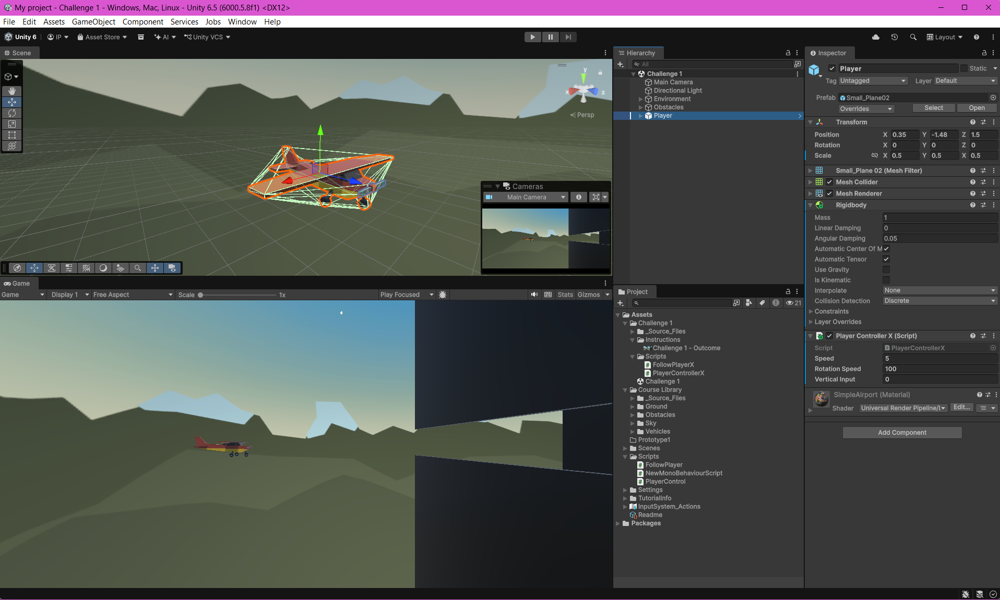
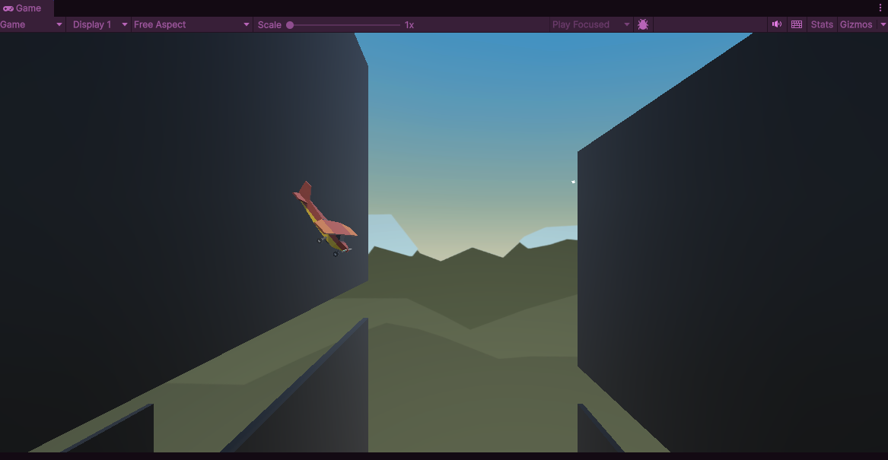
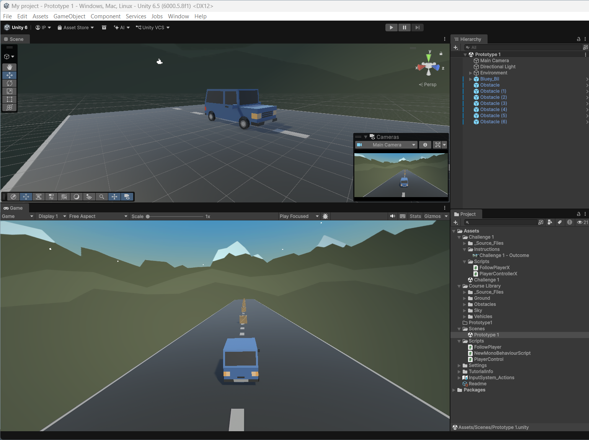
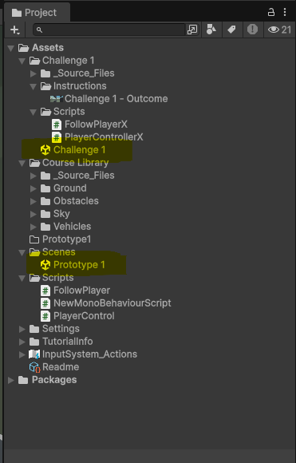

# Ohjauspelit (C# & Unity)

 Kaksi C#-kielellä toteutettua minipeliä samassa Unity-projektissa:
- **Lentokonepeli** – ohjaa lentokonetta esteiden läpi
- **Autopeli** – aja autolla osumatta esteisiin

## Teknologiat
- C# 
- Unity 6.5

## Ominaisuudet
- Kaksi erillistä ohjailupeliä samassa projektissa
- Yksinkertainen esteiden väistely
- Nuolinäppäinohjaus molemmissa peleissä

## Ohjaus
| Näppäin | Toiminto          |
|---------|-------------------|
| ↑       | Eteen / ylös      |
| ↓       | Taakse / alas     |
| ←       | Vasemmalle        |
| →       | Oikealle          |

## Esivaatimukset
- Visual Studio (suositeltava koodieditori)
- Unity versio 6.5 (tai yhteensopiva versio)
- Unity Hub

## Käyttöönotto ja testaus
1. Kloonaa repositorio koneellesi:
```bash
git clone https://github.com/iidapartanen-dev/ohjauspelit.git
```
2. Avaa Unity Hub → Add → valitse kloonattu projektikansio (My project).
3. Avaa projekti Unity Editorissa.
4. Valitse haluamasi peli Scenes-kansiosta (tai File → Open Scene) ja paina Play.
Huom: Molemmat pelit käyttävät nuolinäppäimiä.

Pelin vaihtaminen tapahtuu vaihtamalla Sceneä (katso kuvakaappaus alla).

## Kuvakaappaukset

### Lentokonepeli


### Peli käynnissä


### Autopeli


### Pelin vaihto



